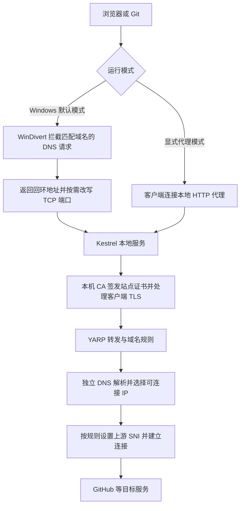

# FastGithub 原理与 issue 修复说明

分析日期为 2026 年 10 月 20 日。代码来自 [creazyboyone/FastGithub](https://github.com/creazyboyone/FastGithub)，克隆时 master 的提交为 `f5425ec`。本次改动保存在本地 `fix/issue-regressions` 分支。

FastGithub 通过本地代理、独立 DNS 解析、连接测速和自定义 TLS SNI 改善访问。它依赖现有网络能够连通目标服务；修改 DNS 和 SNI 无法保证解决所有连接重置或上游不可达问题。本次修复了可由代码和本地测试验证的缺陷，并增加显式代理模式来绕开 Windows 本地服务冲突。

## 请求处理原理



Windows 默认模式使用 WinDivert 在网络层拦截 UDP 53 查询，只对配置匹配的域名返回 `127.0.0.1` 或 `::1`。HTTP、HTTPS、SSH 和 git 协议随后进入本地监听器；原端口被占用时，TCP 拦截器会将回环流量端口改写到另一个可用端口。代码位于 `FastGithub.PacketIntercept` 和 `GlobalListener`。

Linux/macOS 使用显式 HTTP 代理，默认监听 `localhost:38457`。新增的 Windows 显式模式复用这条处理路径。PAC 脚本只让配置中的域名走代理；不支持 PAC 的客户端可以单独指定代理。

对于 HTTPS，客户端先与本地代理完成 TLS 握手，代理使用每台机器自行生成的 CA 为站点签发证书，再与真正的上游建立独立 TLS 连接。因而客户端必须信任本机 CA。某些应用使用独立证书库或证书固定，仍可能不接受这些证书。

上游请求由 YARP 和自定义 `HttpClientHandler` 处理。后者接管建连，利用 `dnscrypt-proxy` 和备用 DNS 获取地址，并按照域名配置选择原始域名、IP、随机值或空 SNI。`IPAddressService` 以 TCP 建连耗时排序，并缓存成功和失败结果。这衡量的是建连速度，不等同于实际下载吞吐量。

## 主要代码位置

| 位置 | 作用 |
| --- | --- |
| `FastGithub/Startup.cs` | 选择运行模式、监听端口、注册后台服务和中间件 |
| `FastGithub.Configuration` | 域名规则、目标地址、超时和 TLS 配置 |
| `FastGithub.DomainResolve` | dnscrypt-proxy 管理、DNS 查询、地址持久化和测速 |
| `FastGithub.PacketIntercept` | Windows DNS 和回环 TCP 流量拦截 |
| `FastGithub.HttpServer` | 本地 CA、TLS、HTTP 和 TCP 代理 |
| `FastGithub.Http` | 上游 HTTP 连接、SNI、证书校验和连接生命周期 |
| `FastGithub.UI` | Windows 托盘、日志与流量图；核心加速进程独立运行 |

## 已处理的问题

| Issue 或代码缺陷 | 判断和修改 | 验证范围 |
| --- | --- | --- |
| [6](https://github.com/creazyboyone/FastGithub/issues/6)、[7](https://github.com/creazyboyone/FastGithub/issues/7) 版本解析导致启动失败 | 当前源码已经给无 `+` 版本加了边界检查，但 `2.1.5-beta.1+hash` 仍会把预发布后缀传给 `Version.Parse`。增加 `TryParse`，拆分预发布后缀与构建元数据；静态初始化遇到无效值返回空，由现有启动日志逻辑回退为 `0.0`。 | 覆盖普通、带 hash、预发布、四段版本、无效输入和构建元数据比较；不再依赖发行包是否含 hash。 |
| [13](https://github.com/creazyboyone/FastGithub/issues/13) Docker 示例反复克隆失败 | 原命令每次启动都克隆到同一目录，还使用与当前 Linux 代码不一致的 `.cer` 文件名。改为等待 CA、兼容 `.crt/.cer`、复用完整 checkout、在临时目录克隆成功后再移动；最多自动重试三次。`build` 等待 `sample` 成功完成。 | 使用本地真实 Git 仓库验证首次克隆、重复运行保留本地文件、证书兼容、缺少证书和失败重试；未在 Docker 引擎中启动镜像。 |
| [11](https://github.com/creazyboyone/FastGithub/issues/11) 系统代理模式需求；[23](https://github.com/creazyboyone/FastGithub/issues/23) localhost 网站冲突 | TCP 过滤条件包含所有回环流量，在 80 端口被占用时可能把 IIS 请求送到 FastGithub。新增 `FastGithub:EnablePacketIntercept=false`，在 Windows 使用显式代理，不注册 DNS/TCP 拦截器，仅监听配置中的代理端口。 | 本地启动实际监听器，验证 PAC 和 HTTP 请求转发；确认只注册代理监听地址且没有拦截后台服务。它是可用的绕行模式，默认透明模式的冲突尚未根治。 |
| [2](https://github.com/creazyboyone/FastGithub/issues/2)、[24](https://github.com/creazyboyone/FastGithub/issues/24)、[1](https://github.com/creazyboyone/FastGithub/issues/1) 构建和启动器困惑 | Linux/macOS 工作流不再还原或编译包含 Windows WPF 的整个解决方案；Windows 单独发布界面。README 区分源码与 Release，并提供完整构建命令。取消发布裁剪，保留配置绑定和反射依赖。 | Windows 完整解决方案 Release 构建通过；核心和 UI 均发布到同一可运行目录。云端 Actions 尚未执行。 |
| [17](https://github.com/creazyboyone/FastGithub/issues/17) Apple Silicon CPU 类型错误 | CI 和 Release 矩阵增加 `osx-arm64`，同时使用已有的 ARM64 dnscrypt-proxy 资源；非 Windows 打包时显式设置可执行权限。 | Windows 上完成 ARM64 交叉发布，并检查核心与 DNS 二进制的 Mach-O ARM64 标识；未验证 macOS 实际运行。 |
| [29](https://github.com/creazyboyone/FastGithub/issues/29) 502 和连接重置相关链路 | 确认 HTTP 连接和 TLS 握手失败时存在资源未释放的路径，已关闭失败 Socket/TLS 流；TCP 代理返回的流改为拥有底层 Socket。另修复自定义端口从 Host 请求头丢失的问题。 | 本地服务验证失败 TLS 握手后对端收到连接关闭，以及非默认端口 Host 保留。现有 issue 日志不足以断定资源泄漏就是远端重置的根因，未声称已解决全部 502。 |
| 上游证书校验绕过 | 旧回调在名称不匹配时，可能同时忽略不可信证书链。现在自定义 SNI 只允许放宽名称匹配，其余证书错误仍拒绝。 | 用本地自签名 TLS 服务测试 `TlsIgnoreNameMismatch` 开启和关闭两种情况，均拒绝不可信证书链。 |
| 启动时修改 Git 全局设置 | 移除自动执行 `git config --global http.sslverify false` 的逻辑，同步更新 Markdown 和 HTML 说明，提供按次指定 CA 的方法。 | 已检查调用路径被移除；不会自动重置用户以前保存的 Git 设置，旧配置的清理方法见 README。 |

## Hugging Face 支持

新增 `FastGithub/appsettings/appsettings.huggingface.json`，应用启动时会自动加载 `appsettings` 目录中的子配置，因此无需更改主配置文件。规则覆盖 Hub 主机、`hf.co` 短域名、模型文件使用的 LFS/Xet 传输与 CDN 主机、Inference Router，以及 `*.hf.space` Spaces 主机；通过 `TlsSni: true` 保留访问的原始主机名。域名来源包括 [Hugging Face 官方 Hub metadata](https://huggingface.co/.well-known/meta.json) 和[下载网络配置文档](https://huggingface.co/docs/hub/models-downloading)。

该配置只让这些主机经过 FastGithub 的 DNS、连接和 TLS 代理流程，不会绕过登录、访问令牌、仓库权限或 Hugging Face 客户端自身的设置，也不能保证所有网络环境下的大文件都能下载成功。官方 CDN 列表会变化，网络策略严格时应按官方 metadata 更新配置。

## 使用修复后的版本

Windows 完整输出位于 `publish/win-x64`，包含 `fastgithub.exe`、`FastGithub.UI.exe`、配置和 `dnscrypt-proxy`。需要保留整个目录结构。构建产物由 Git 忽略，源码改动保留在工作区。

遇到 IIS 或 localhost 冲突时，先退出透明模式实例，在发布目录运行：

```powershell
.\fastgithub.exe FastGithub:EnablePacketIntercept=false
```

然后在客户端配置自动代理地址 `http://127.0.0.1:38457`，或者为 Git 单次指定 HTTP 代理和本机 CA。此模式仍需要客户端信任 CA，但不加载 WinDivert 拦截器。新版界面可在「连接设置」中切换模式，并通过独立回环端口读取统计数据，显式模式下也可以查看流量。

## Windows 界面完善

界面沿用 WPF 和浅色蓝色强调，采用代理客户端常见的侧栏导航，保留原生窗口操作。概览显示本地核心状态、启停操作、上下行速率与累计流量；没有数据时显示空状态，统计不可用时停止展示实时速率。服务就绪只代表本地核心已响应，不代表 GitHub 公网可达。

运行日志支持消息和来源搜索、级别筛选、暂停自动滚动、复制、清空以及导出筛选结果，最多保留 500 条。连接设置提供透明与显式代理模式、随界面启动核心的偏好、代理地址复制、配置与证书目录入口。模式切换需要先停止服务；此偏好不添加 Windows 开机自启任务。

启动核心使用发布目录的绝对路径。界面为自己启动的核心创建独立停止事件，请求核心走正常退出流程，不直接强杀进程。托盘菜单和窗口共用启停操作；退出时等待核心停止。流量统计使用只接受统计请求的独立回环监听器，避免与 PAC、IIS 或不同运行模式冲突。

帮助页面改为本地 WPF 内容，移除对嵌入式 IE 和远程 CSS 的运行依赖。可执行 `scripts/preview-ui.ps1` 生成 980×720 与 860×620 窗口尺寸下的原生截图，并检查导航及日志筛选。预览中的流量与日志均明确标注为示例，不启动核心或导入系统根证书。

## 验证结果

本地环境为 Windows x64、.NET SDK 7.0.410 和运行时 7.0.20。

| 检查 | 结果 |
| --- | --- |
| 完整解决方案 Release 构建 | 通过，0 警告、0 错误 |
| .NET 回归测试 | 17 项通过，包含界面正常停止信号与独立统计监听器 |
| Docker 示例脚本回归测试 | 5 项通过 |
| Windows 自包含单文件核心与 UI 发布 | 通过 |
| macOS ARM64 自包含交叉发布 | 通过；尚未实机运行 |
| Shell 语法检查 | 通过 |
| Compose 和 Actions YAML 语法检查 | 通过；Docker Compose 完整配置校验交由 CI 执行 |
| 原生 WPF 界面 | 10 张截图覆盖两种窗口尺寸、空状态、示例流量、日志筛选、设置与帮助；独立设计复核通过 |

代理集成测试只使用临时目录中的 CA、本地测试服务器和替代解析器，并禁用证书安装器与后台拦截服务。它们不导入系统根证书、不启动实际 DNS 进程，也不依赖公网可达性。

## 仍需处理的问题

- **透明模式的回环地址冲突**：要彻底修复，需要将 FastGithub 的虚拟目标地址与普通 localhost 流量分开，并同时验证 IPv4、IPv6、端口冲突和 DNS 缓存恢复。新增显式模式可先避开冲突。
- **网络不稳定**：[19](https://github.com/creazyboyone/FastGithub/issues/19)、[15](https://github.com/creazyboyone/FastGithub/issues/15)、[27](https://github.com/creazyboyone/FastGithub/issues/27)、[29](https://github.com/creazyboyone/FastGithub/issues/29) 需要同一环境下的 DNS 结果、目标 IP、TLS 握手和实际下载记录。当前测速只测 TCP；可连接的 IP 仍可能在 TLS 或传输阶段失败。不应为未知网络故障自动重放 POST、上传或 Git push。
- **证书和系统兼容性**：[8](https://github.com/creazyboyone/FastGithub/issues/8) 的 Apple Keychain 异常不能靠换 ARM64 包解决，需要在对应 macOS 实机上验证证书生成及重新加载。[5](https://github.com/creazyboyone/FastGithub/issues/5) 的微软登录也需要确定受影响应用的证书库和代理行为。
- **运行时过旧**：项目仍基于已停止支持的 [.NET 7](https://dotnet.microsoft.com/en-us/download/dotnet/7.0)，UI 基于 .NET Framework 4.5。升级运行时、依赖和 UI 需要独立兼容性验证，本次没有混入整体迁移。
- **驱动与安全软件**：[16](https://github.com/creazyboyone/FastGithub/issues/16)、[18](https://github.com/creazyboyone/FastGithub/issues/18)、[28](https://github.com/creazyboyone/FastGithub/issues/28) 仍需原机错误码和具体发行二进制的检测结果，不能仅凭源码认定所有拦截均属误报。
- **界面及启动体验**：[22](https://github.com/creazyboyone/FastGithub/issues/22) 的启停按钮已在本地界面中实现；[26](https://github.com/creazyboyone/FastGithub/issues/26) 的管理员开机自启尚未实现；[14](https://github.com/creazyboyone/FastGithub/issues/14)、[25](https://github.com/creazyboyone/FastGithub/issues/25) 需要提取截图中的具体异常后才能归因。

本次没有启动实际加速服务、注册系统服务、推送远程分支或发布 GitHub Release。Docker 引擎和 Linux/macOS 实机验证仍待完成，CI 已加入对应的可执行检查步骤。
